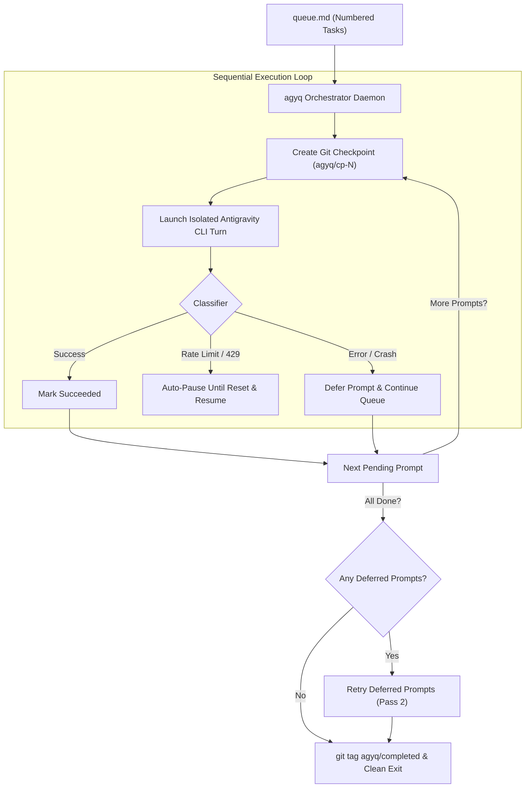

# agyq

[](https://golang.org)
[](LICENSE)
[](#)
[](#)
[](#)

Sequential, crash-safe prompt queue runner for the **Antigravity CLI (`agy`)**, engineered for autonomous, unattended execution overnight on a local workstation, Linux VM, or home server.

> **Status:** Production-ready (`v1.0.0`). Standard library only (zero external dependencies).

<p align="center">
  
</p>

---

## Why `agyq`?

Running autonomous coding agents unattended often encounters common points of failure:
- **Context degradation:** Long multi-turn conversations degrade in quality, hit context limits, and lose track of earlier constraints.
- **Power cuts & crashes:** An unexpected reboot or process termination can corrupt uncommitted progress and leave state inconsistent.
- **API rate limits:** Quota exhaustion and session windows halt execution unexpectedly.
- **Single-prompt queue halt:** A single broken test or compilation failure aborts the entire overnight run, stranding all downstream tasks in pending.
- **Silent tool denials:** In headless mode, commands requiring confirmation are auto-denied by default, causing false successes where the agent exits in seconds without writing code.

### Manual CLI vs. `agyq` Daemon

| Failure Mode | Conventional Manual CLI | With `agyq` Daemon |
|:---|:---|:---|
| **Multi-task fatigue** | Conversation grows huge, hallucinates, degrades | Fresh isolated conversation per prompt with repository state |
| **Quota limit (429 / Reset)** | Process crashes or hangs; night wasted | Automatically detects reset time, sleeps, and resumes |
| **Middle-of-the-night crash** | Partial files left uncommitted; repo broken | Instant Git rollback & contextual resume preamble |
| **Mid-queue prompt failure** | Halts entire queue; downstream prompts stranded | **Deferred to end of queue** (`retry-at-end`); remaining tasks complete |
| **Headless / Server deployment** | Requires manual terminal babysitting | Native `systemd` unit for Proxmox, LXC, and Linux VMs |
| **Errors & Visibility** | Buried in stdout/stderr terminal noise | Dedicated `.agyq/errors.log` & `agyq errors` CLI viewer |

### Core Architectural Features

1. **Prompt Isolation:** Each prompt runs in a **fresh** agent conversation. Long-term architectural context lives in repository files (code, tests, and documentation), avoiding conversational drift.
2. **Git Checkpoints:** Automatically creates a Git checkpoint commit (`agyq/cp-N`) before each prompt and a completion commit (`agyq/completed`) after the queue finishes. If interrupted, `agyq` resumes work safely without repeating completed tasks.
3. **Quota Resilience:** Intercepts rate limits and quota resets, pauses execution until quota is restored, and resumes automatically.
4. **Deferred Retry-at-End (Default Failure Policy):** If a prompt fails, `agyq` skips it for the moment, continues running all remaining prompts, and returns to retry the failed prompt at the end of the queue with contextual diagnostics.
5. **False-Success Guard:** Inspects the CLI output for auto-denied actions (`denied_actions`) and immediately flags the prompt as failed and retries, rather than falsely claiming success.
6. **Dedicated Error Diagnostics:** Appends detailed diagnostic records (attempt, exit code, transcript path, stderr tail) directly to `.agyq/errors.log`, viewable anytime with `agyq errors`.
7. **Zero External Dependencies:** Built entirely with the Go standard library, ensuring zero dependency bloat and instant compilation.

---

## Architecture Flow



---

## Documentation Index

| Guide | Description |
|---|---|
| [**User Guide**](docs/USER-GUIDE.md) | Authoring effective prompts, repository conventions (`AGENTS.md`), queue workflows, and batch management |
| [**CLI Reference**](docs/CLI-REFERENCE.md) | Detailed documentation of all commands, flags, arguments, exit codes, and control signals |
| [**Configuration Reference**](docs/CONFIGURATION-REFERENCE.md) | Schema specification for `agyq.json` (models, effort, permissions, timeouts, retries, limits) |
| [**Troubleshooting Guide**](docs/TROUBLESHOOTING.md) | Diagnosing common issues, permission auto-denials, quota pauses, and reading transcripts |
| [**Server & Proxmox Runbook**](docs/DEPLOYMENT-PROXMOX.md) | Deploying unattended on Debian/Ubuntu VMs, LXC containers, and home servers with systemd |

---

## Prerequisites

- **Go:** ≥ 1.22 (if building from source)
- **Git:** Initialized in your target project directory
- **Antigravity CLI (`agy`):** Installed and authenticated

```bash
# Install Antigravity CLI (if not already installed)
curl -fsSL https://antigravity.google/cli/install.sh | bash

# Authenticate once interactively
agy
# (Complete Google browser authentication, then type /exit)
```

---

## Installation

### Option 1: Install via APT (Debian, Ubuntu, Proxmox LXC)

Add the official APT repository and install `agyq` with automatic package updates:

```bash
# 1. Add repository & trusted GPG key automatically
curl -1sLf 'https://dl.cloudsmith.io/public/agyq/agyq/setup.deb.sh' | sudo -E bash

# 2. Update and install agyq
sudo apt update
sudo apt install agyq
```

To update `agyq` in the future:
```bash
sudo apt update && sudo apt install --only-upgrade agyq
```

### Option 2: Download Standalone .deb Package

Download the `.deb` package directly from [GitHub Releases](https://github.com/VishalRashmika/agyq/releases):

```bash
curl -LO https://github.com/VishalRashmika/agyq/releases/latest/download/agyq_linux_amd64.deb
sudo apt install ./agyq_linux_amd64.deb
```

### Option 3: Build from Source

```bash
git clone https://github.com/VishalRashmika/agyq.git
cd agyq
make build
sudo install -m 0755 agyq /usr/local/bin/agyq
```

Verify installation:
```bash
agyq version
```

---

## Core Operations Workflow

### 1. Initiating a Fresh Project (`agyq init`)

Navigate to your Git repository (or run `git init` first) and run:

```bash
cd ~/work/myproject
agyq init
```

This scaffolds and configures everything needed:
- **`queue.md`**: Starter prompt queue with formatting examples (`# #1 Title`).
- **`agyq.json`**: Pre-configured with `"permission_mode": "dangerously-skip-permissions"` and `"on_failure": "retry-at-end"` by default, allowing headless tool execution (terminal commands, file creation, and edits) without human confirmation prompts.
- **`AGENTS.md`**: Autonomous worker guidelines auto-loaded by `agy`, instructing the agent to always modify files directly and run tests rather than merely explaining solutions in text.
- **`.gitignore`**: Automatically appends `.agyq/`, `queue.md`, cache files, and logs so runtime state is never accidentally committed to Git.
- **Doctor Preflight**: Executes a 9-point diagnostic verifying the `agy` binary, login credentials, and repository readiness.

---

### 2. Running the Queue

Edit `queue.md` with your tasks, then choose your execution mode:

```bash
# Preview execution order and validate queue syntax
agyq plan

# Option A: Run in foreground (interactive terminal or tmux)
agyq run

# Override failure policy if desired (default: retry-at-end)
agyq run --on-failure retry-at-end   # Defer failures, finish queue, retry at end
agyq run --on-failure continue       # Continue immediately without retry
agyq run --on-failure stop           # Halt queue immediately on failure

# Option B: Run as an unattended background service (systemd)
sudo agyq service install    # Auto-detects user, working dir, and PATH
sudo agyq service start      # Starts background runner
sudo agyq service status     # Checks daemon health
journalctl -u agyq -f        # Tails live execution log
```

Monitor live status from any terminal:
```bash
agyq status
```

Inspect error diagnostics:
```bash
agyq errors                  # View recent failures with transcripts and stderr
agyq errors --tail 20        # Inspect last 20 error entries
```

---

### 3. Queue Live Controls

While the queue is running, manage execution safely using control commands:

```bash
agyq pause        # Gracefully pause after the active prompt finishes
agyq resume       # Resume execution after a pause
agyq skip 2       # Skip prompt #2
agyq retry 3      # Clear failure count and retry prompt #3
```

---

### 4. Reviewing Commits & Starting a New Batch (`agyq reset`)

When all prompts in the queue finish, `agyq` automatically creates a final checkpoint commit (`agyq: queue completed` tagged `agyq/completed`).

```bash
# 1. Review commits and inspect changes
git log --oneline -n 15
git diff agyq/cp-1 agyq/completed

# 2. Run your project tests or build checks
go test ./...  # or npm test / pytest
```

If your new `queue.md` restarts numbering from `# #1`, reset the state so `agyq` does not treat `#1..#N` as already completed:

```bash
# Stop background service if running
sudo agyq service stop

# Archive previous run and reset state
agyq reset

# Update queue.md with your new tasks
vim queue.md

# Preview and start
agyq plan
agyq run
```

*(Note: If you are simply **appending** new prompts without resetting numbers, e.g. adding `# #13..` to the existing queue, you do not need to run `agyq reset`. `agyq` will automatically pick up `#13` onward).*

---

## Command Summary

| Command | Summary |
|---------|---------|
| `agyq init` | Scaffolds `queue.md`, `agyq.json`, `AGENTS.md`, configures `.gitignore`, and runs preflight doctor |
| `agyq plan` | Previews prompt execution order and validates queue syntax |
| `agyq run` | Runs prompts sequentially, checkpointing Git before each prompt |
| `agyq status` | Displays queue progress, prompt states, retry attempts, and event stream |
| `agyq errors` | Displays recent diagnostic errors, failure reasons, transcripts, and stderr tails |
| `agyq doctor` | Comprehensive 9-step preflight diagnosis for CLI, Git, quota, and credentials |
| `agyq pause` | Signals running queue to pause gracefully after current prompt completes |
| `agyq resume` | Clears pause signal and resumes execution |
| `agyq skip <N>` | Marks pending or interrupted prompt `#N` as skipped |
| `agyq retry <N>` | Resets failed prompt `#N` to pending and clears attempt counter |
| `agyq reset` | Archives completed run (`state.json`, transcripts) to `.agyq/archive/<timestamp>/` and resets for next batch |
| `agyq service install` | Generates and installs a systemd unit with auto-detected paths and permissions |
| `agyq service status` | Checks systemd service status |
| `agyq service start` | Starts background systemd daemon |
| `agyq service stop` | Stops background systemd daemon |
| `agyq version` | Prints binary version and Git commit |

---

## Queue File Format (`queue.md`)

`queue.md` is standard Markdown containing level-1 headings formatted as `# #<number> <Title>`:

```markdown
# #1 Setup Database Schema
Create migration scripts for Postgres user tables under db/migrations/.
Acceptance criteria:
- Run migrations up and down cleanly.
- Add Go structs in internal/db/models.go.

# #2 Add Authentication Handlers
Implement user login and token generation.
Done when:
- go test ./internal/auth/... passes.
```

Prompts can be added to `queue.md` dynamically at any time, even while `agyq` is executing.

---

## Building & Testing

To compile or run tests locally:

```bash
make build    # Build binary (./agyq)
make test     # Run all unit and integration tests
make check    # Complete verification (build + lint + test)
```
